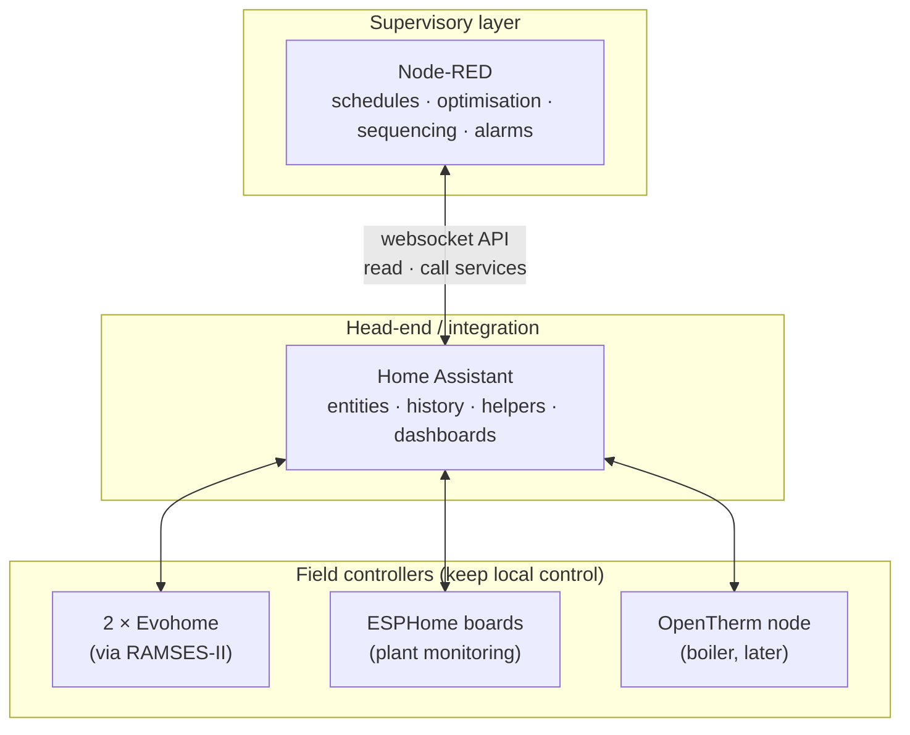

# Home Assistant + Node-RED Supervisory Layer: The BMS "Head-End" for a Home (In Progress)

**Home Assistant as the data and integration layer, Node-RED as the supervisory logic layer, and the existing field controllers (two Honeywell Evohome systems, ESPHome boards, the OpenTherm node) left in charge of their own plant, exactly as a BMS supervisor sits above DDC controllers. This repo defines the platform, command authority, safety patterns and conventions that the supervisory functions (optimum start/stop first) are built on.**

-orange)

> **The short version:**
> - **Three layers, like a BMS:** field controllers run the plant; HA collects and exposes everything; Node-RED decides **when** and **what** to ask of them.
> - **The supervisor never becomes a single point of failure:** every field controller keeps a safe local behaviour if Node-RED or HA stops.
> - **Command authority is tiered:** reads are free; writes are limited, logged, rate-limited and confirmed by read-back.
> - **First function on it:** [multi-zone optimum start/stop](https://github.com/the-control-cabinet/optimum-start-stop-supervisory). Later: alarm and trend strategy, OpenTherm preheat signals, rig supervision.
>
> Node-RED has already been used in the lab projects ([Modbus TCP](https://github.com/the-control-cabinet/modbus-tcp-data-collector), [BACnet/IP](https://github.com/the-control-cabinet/bacnet-ip-network-explorer)); this repo brings it into the live system.

**Delivery sequence:** A plant-monitoring baseline → **B supervisory layer (this repo)** → C optimum start/stop → E OpenTherm (D, the PID rig exercise, runs in parallel). See the [portfolio hub](https://github.com/the-control-cabinet).

**Portfolio position:** Management level · supervisory control (portfolio #3). Related: [HA integration schedule](https://github.com/the-control-cabinet/home-assistant-integration-schedule) · [Security baseline](https://github.com/the-control-cabinet/smart-home-security-baseline) · [Evohome & RAMSES-II](https://github.com/the-control-cabinet/evohome-heating-controls-ramses-integration)

---

## Architecture

| BMS layer | Here | Keeps working if the layer above fails? |
|---|---|---|
| Management / supervisory | **Node-RED** | n/a |
| Automation / head-end | **Home Assistant** | Yes: dashboards and automations continue without Node-RED |
| Field / DDC | Evohome, ESPHome, OpenTherm node | **Yes:** each runs its own schedule or safe defaults |

## Documents
| Doc | Contents |
|---|---|
| [01 Platform setup](docs/01-platform-setup.md) | Add-on, HA websocket nodes, access token, versions, backups, flows in Git |
| [02 Command authority](docs/02-command-authority.md) | Read/write tiers, RAMSES-II commands, rate limits, read-back, audit log |
| [03 Supervisor patterns](docs/03-supervisor-patterns.md) | Heartbeat, stale data, fail-safe, timeouts, alarms |
| [04 First flows and the functions it hosts](docs/04-flows-and-functions.md) | Round-trip proof flow; the roadmap of functions |

## Roadmap
- [ ] Node-RED add-on on the live HA, with the HA websocket nodes and a dedicated, least-privilege access token
- [ ] Conventions: flow naming, a shared "supervisor" helper group, flows exported to this repo
- [ ] Patterns: heartbeat entity, stale-data guard, command log
- [ ] Proof flow: read a zone temperature → send a **temporary** setpoint over RAMSES-II → confirm read-back → confirm reversion at expiry
- [ ] Host [optimum start/stop](https://github.com/the-control-cabinet/optimum-start-stop-supervisory) (shadow mode first)
- [ ] Later: alarm and trend strategy (#6), OpenTherm preheat signal, rig supervision (#7/#9)

## Skills demonstrated (as built)
| Skill | Evidence |
|---|---|
| Supervisory architecture | Three-layer design with local fall-back at each level |
| Command authority | Tiered writes, rate limits, read-back, audit log |
| Resilience | Heartbeat, stale-data handling, fail-safe defaults |
| Configuration management | Flows exported to Git, pinned versions, backups |

📺 [The Control Cabinet on YouTube](https://www.youtube.com/channel/UC5Cupmz7vlfcodpCX7k8iuQ)

*Built and documented by James · part of [The Control Cabinet BMS portfolio](https://github.com/the-control-cabinet). MIT Licence.*
